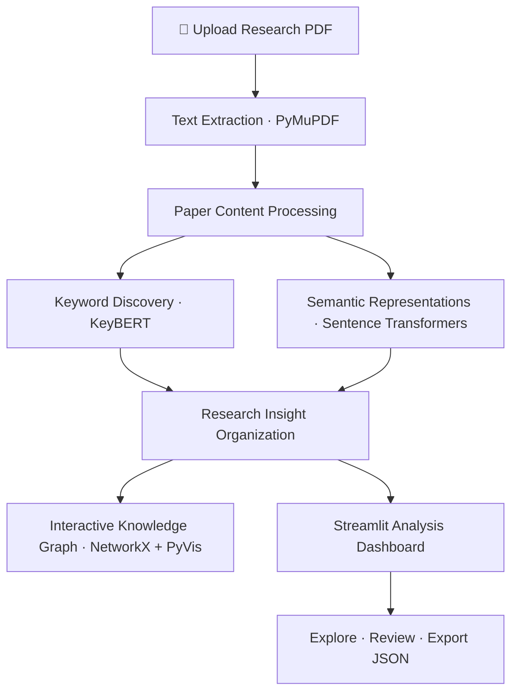

# PaperGraph

<p align="center">
  <strong>Turn research papers into insights, not hours of reading.</strong>
</p>

<p align="center">
  An AI-powered research paper analyzer that extracts key information from PDFs, surfaces research insights, and transforms academic text into an interactive knowledge graph.
</p>

<p align="center">
  <a href="https://streamlit.io/"></a>
  <a href="https://www.python.org/"></a>
  <a href="https://github.com/features/actions"></a>
  
</p>

---

## ✦ The idea

Research papers are packed with valuable ideas—but finding the important ones can take hours.

**PaperGraph** helps make that process more structured. Upload a research paper, extract its text, explore NLP-generated insights, and visualize relationships between concepts in an interactive graph.

Instead of treating a paper as a wall of text, PaperGraph turns it into something you can explore.

## ✨ Features

| Feature | What it does |
|---|---|
| 📄 **PDF Intelligence** | Extracts text from uploaded research papers using PyMuPDF. |
| 🧠 **Keyword Discovery** | Uses KeyBERT to identify candidate keywords and important concepts. |
| 🔎 **Research Insights** | Organizes extracted content into potential problem statements, research gaps, methods, and findings. |
| 🕸️ **Knowledge Graphs** | Builds interactive graph visualizations connecting the paper to its extracted concepts and insights. |
| 📚 **Document Exploration** | Browse extracted text and available paper sections in the app. |
| 📦 **JSON Export** | Export structured analysis results for further processing. |
| 🎨 **Interactive Dashboard** | Explore results through a Streamlit interface with dedicated analysis views. |

> **A note on AI-generated insights:** Research problems, gaps, methods, and findings are extracted or inferred from the available text. They are not guaranteed to be explicitly stated or scientifically validated. Always verify important conclusions against the original paper.

## 🖥️ How it works



## 🛠️ Tech stack

<p>
  
  
  
  
  
  
  
</p>

| Technology | Role |
|---|---|
| Python | Core application logic |
| Streamlit | Interactive web application |
| PyMuPDF | PDF text extraction |
| KeyBERT | Keyword extraction |
| Sentence Transformers | Semantic text representations |
| NetworkX | Graph construction and relationship modeling |
| PyVis | Interactive graph visualization |

## 🚀 Run locally

### 1. Clone the repository

```bash
git clone https://github.com/YOUR_USERNAME/PaperGraph.git
cd PaperGraph
```

Replace `YOUR_USERNAME` with your GitHub username.

### 2. Create a virtual environment

**Windows — PowerShell**

```powershell
python -m venv .venv
.\.venv\Scripts\Activate.ps1
```

If PowerShell blocks environment activation, you can run the environment's Python directly instead.

### 3. Install dependencies

```bash
python -m pip install --upgrade pip
pip install -r requirements.txt
```

### 4. Launch PaperGraph

```bash
python -m streamlit run app.py
```

Open the local URL shown in your terminal, usually:

`http://localhost:8501`

**First launch:** NLP libraries may download pretrained model files. The initial startup can take longer than subsequent runs.

## 📂 Project structure

```text
PaperGraph/
├── app.py                # Streamlit application and dashboard
├── pdf_ingestion.py      # PDF text extraction
├── paper_analysis.py     # NLP analysis and insight extraction
├── knowledge_graph.py    # Knowledge graph generation
├── requirements.txt      # Python dependencies
├── .gitignore            # Excluded files and generated artifacts
└── README.md             # Project documentation
```

Generated outputs and local virtual-environment files should remain outside version control unless intentionally included.

## 🌐 Deployment

PaperGraph can be deployed using [Streamlit Community Cloud](https://share.streamlit.io/).

1. Push the project to a GitHub repository.
2. Sign in to Streamlit Community Cloud with GitHub.
3. Create an app and select the repository and `main` branch.
4. Set `app.py` as the main file.
5. Deploy and test the hosted app with a sample PDF.

Deployment success depends on compatible dependency versions and available resources. Test the full application in a clean environment before publishing.

## 🔭 Roadmap

- [ ] Improve research-gap extraction and evidence tracing.
- [ ] Add paper summaries with links to supporting passages.
- [ ] Compare multiple papers to identify common themes and conflicting findings.
- [ ] Build cross-paper knowledge graphs.
- [ ] Add citation and reference analysis.
- [ ] Improve handling of scanned PDFs and tables.
- [ ] Add evaluation using a curated set of research papers.
- [ ] Publish a stable hosted demo.

## ⚠️ Current limitations

- PDF extraction quality depends on the document's layout and text encoding.
- Scanned PDFs may require OCR, which is not currently guaranteed.
- Extracted insights may be incomplete, inaccurate, or inferred rather than explicitly stated.
- A graph edge represents a modeled relationship, not proof of a scientifically established connection.
- Large documents and first-time model downloads may require additional memory and processing time.

## 🤝 Contributing

Ideas, bug reports, and thoughtful improvements are welcome.

1. Fork the repository.
2. Create a feature branch.
3. Make your changes and test them locally.
4. Open a pull request describing the change.

## 📜 License

No license has been specified yet. Add a `LICENSE` file before presenting the project as open source or granting broad reuse permissions.

---

<p align="center">
  <strong>Read smarter. Connect ideas. Discover what's next.</strong>
  <br>
  <sub>PaperGraph · AI-assisted research exploration</sub>
</p>
